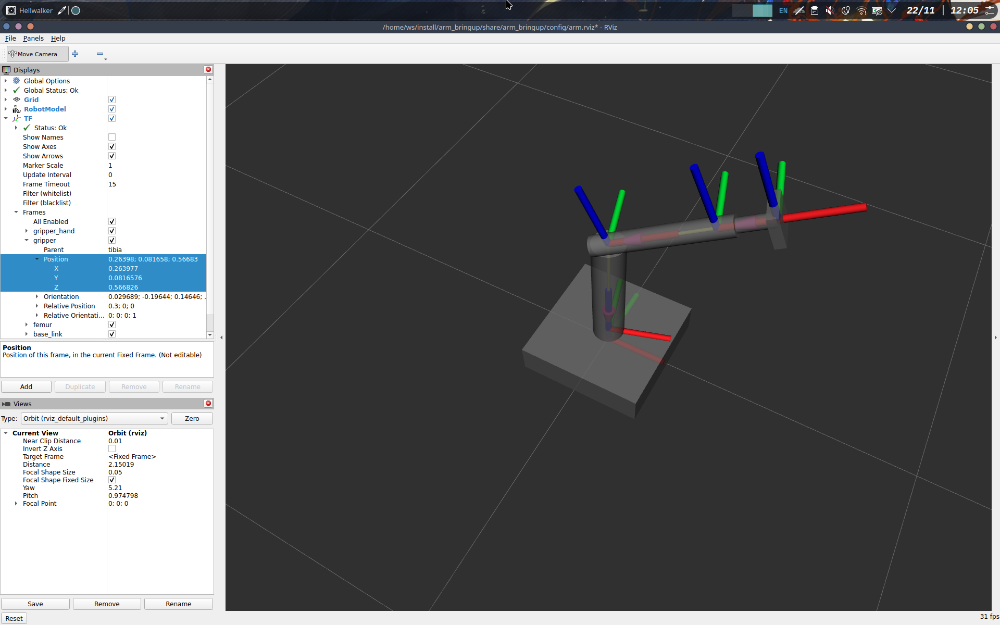
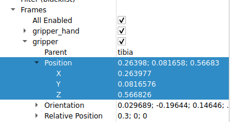
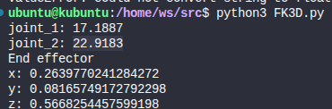

# MAGANG AL-FATIH 
# PERTEMUAN 3 
Summary: publisher, subscriber, 
## KONVERSI QUATERNION KE ROLL, PITCH, DAN YAW (RPY)

Terdapat node `publisher` dan `subscriber` 


# PERTEMUAN 4
Summary: arm control, forward kinematics, 
## SOAL 1

### 1. Kegunaan `<ros2_control>` tag pada file URDF

Tag `<ros2_control>` dipakai untuk mendeskripsikan interface hardware robot ke framework ros2_control (langsung di dalam URDF). Isinya:

- **`<hardware>`**: menentukan plugin hardware interface yang dipakai.
- **`<joint>`**: membuat daftar joint yang dikontrol, beserta:
  - `command_interface` (misal: `position`, `velocity`, `effort`)
  - `state_interface` (misal: `position`, `velocity`)

Tanpa tag ini, `controller_manager` tidak tahu hardware apa yang harus dikelola dan interface apa yang bisa diklaim oleh controller.

---

### 2. Tipe plugin controller pada robot

Berdasarkan `arm_controllers.yaml`, ada dua controller:

| Nama | Tipe plugin | Fungsi |
|------|-------------|--------|
| `joint_state_broadcaster` | `joint_state_broadcaster/JointStateBroadcaster` | Membaca posisi joint saat ini dan mempublikasikannya ke topic `/joint_states` |
| `arm_controller` | `position_controllers/JointGroupPositionController` | Mengirim target sudut (posisi) ke joint `joint_1`, `joint_2`, `joint_3` |

### 3. Node yang dijalankan di `bringup.launch.py`

Ada empat node:

| No | Node | Package | Fungsi |
|----|------|---------|--------|
| 1 | `robot_state_publisher` | `robot_state_publisher` | Membaca `robot_description` (hasil `xacro` dari `arm.urdf`), lalu mempublikasikan transform TF robot |
| 2 | `ros2_control_node` | `controller_manager` | Menjalankan controller manager yang memuat hardware interface dan mengelola controller sesuai `arm_controllers.yaml` |
| 3 | `controller_spawner` | `controller_manager` (executable `spawner`) | Memuat dan mengaktifkan `joint_state_broadcaster` dan `arm_controller` dengan parameter dari `arm_controllers.yaml` |
| 4 | `rviz2` | `rviz2` | Visualisasi robot memakai konfigurasi `arm.rviz` |

## SOAL 2: FORWARD KINEMATICS

TUJUAN: Mencari posisi end effector. 

### Layout Robot
---
Chain pada `arm.urdf` adalah: 

base_link -> `joint_1`-> femur -> `joint_2`-> tibia ->`joint_3 `-> gripper


Ketika semua joints = 0, arm **berbentuk L** (femur vertikal, tibia sepanjang +X).. 

| bagian | nilai (m) |
|---|---|
| `base_link` ke `joint_1` ($h$) | 0.05 |
| Femur ($L_1$) | 0.4 |
| Tibia ($L_2$) | 0.3 |


### Penurunan Rumus
---

$\theta_1$ = `joint_1`, $\theta_2$ = `joint_2`, 

**1. Derajat ke radian**

$$\theta_{rad} = \theta_{deg} \times \frac{\pi}{180}$$

**2. Puncak femur**

$$z_0 = h + L_1$$

**3. Posisi pada bidang lengan** ($r$ = jangkauan horizontal, $z$ = tinggi, sebelum yaw)

Ujung tibia (`joint_3`):

$$r_1 = L_2 \cos\theta_2$$

$$z_1 = z_0 + L_2 \sin\theta_2$$


Sudut dijumlahkan ($\theta_2 + \theta_3$) karena `joint_3` diukur relatif terhadap tibia dan kedua axis-nya sama.

**4. Putar bidang lengan terhadap sumbu Z (yaw)**

$$x = r \cos\theta_1$$

$$y = r \sin\theta_1$$

**5. Hasil akhir**

Frame `gripper` (ujung tibia):

$$x = L_2 \cos\theta_2 \cos\theta_1$$

$$y = L_2 \cos\theta_2 \sin\theta_1$$

$$z = h + L_1 + L_2 \sin\theta_2$$

**Contoh perhitungan manual (default state)** ($\theta_1 = 0$, $\theta_2 = 0$):

$$x = 0.3 \cdot \cos 0 \cdot \cos 0 = 0.3$$

$$y = 0.3 \cdot \cos 0 \cdot \sin 0 = 0$$

$$z = 0.05 + 0.4 + 0.3 \cdot \sin 0 = 0.45$$

### Penerapan dengan Python

File: `src/FK3D.py`
```py
import math

base_h = 0.05
femur  = 0.4    
tibia  = 0.3     

deg1 = math.radians(float(input("joint_1: ")))
deg2 = math.radians(float(input("joint_2: ")))

z0 = base_h + femur           
r = tibia * math.cos(deg2)
z = z0 + tibia * math.sin(deg2)

#rotasi around z
x = r * math.cos(deg1) 
y = r * math.sin(deg1)

print("End effector")
print("x:", x)
print("y:", y)
print("z:", z)
```
**Cara Menjalankan FK3D.py**

```bash
cd src
python3 FK3D.py
```

Masukkan derajat `joint_1` dan `joint_2`. Output berupa nilai x, y, dan z dari end effector (ujung tibia)

### VERIFIKASI
Nilai sudut yang digunakan adalah: 

- joint_1 ($\theta_1$): 0.3 rad (≈ 17.1887)
- joint_2 ($\theta_2$): 0.4 rad (≈ 22.9183)

Tampilan Visual RViz
--
Nilai sudut dari joint 1 dan joint 2 diubah dengan mengganti nilai pada `ARM_POSITION` pada file `arm_publisher.py`:

```py
ARM_POSITION = [0.3, 0.4, 0.0] #satuan radian
```

Setelah dijalankan tampilan pada RViz berubah menjadi:



RViz menampilkan keterangan posisi end effector (gripper`= ujung tibia) sebagai berikut:



Perhitungan Menggunakan Python
---

Memasukkan input: 

- joint_1 ($\theta_1$): 17.1887
- joint_2 ($\theta_2$): 22.9183

Menghasilkan output: 



Perbandingan
---

| Sumbu | RViz | Python |
|---|---|---|
| x | 0.263977 | 0.2639770241284272 |
| y | 0.0816576 |0.08165749172792298 |
| z | 0.566826 |0.5668254457599198 |

Hasil perhitungan python sudah sesuai dengan koordinat pada RViz, selisih terjadi karena adanya perbedaan taraf ketelitian (ketika hasil python dibulatkan, nilainya akan sama). 


# TODO 
tambahin di readme: 
- meeting summaries
- cara menjalankan program 
- deskripsi arm_model 
- Tugas tambahan penjelasan rumus konversi quaternion
